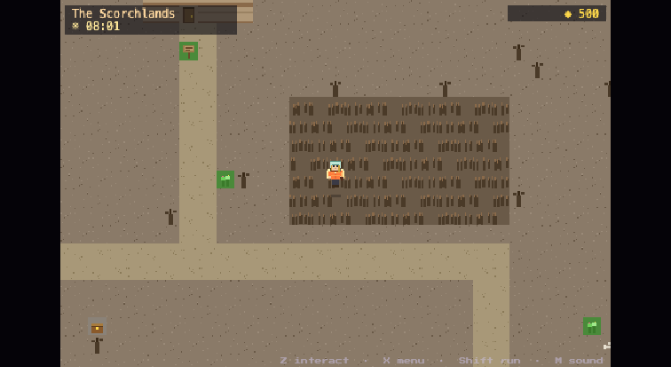

# CINDERWARD — The Dying Flame

A complete, original, fully self-contained pixel RPG in the browser. Inspired by the
*feel* of classic GBA-era RPGs (open overworld, turn-based party battles, collectible
spirit companions) and MMO-style questing and gear — but with **100% original names,
art, code, story, and music**. No third-party assets. See `LEGAL.md`.



## Play

Double-click `index.html` (works offline from `file://`), or serve the folder:

```bash
cd Cinderward-Master
python3 -m http.server 8080
# open http://localhost:8080
```

Everything is procedural — sprites, tiles, and chiptune audio are generated in code.
The pixel font (Press Start 2P, OFL) is embedded as base64. No network needed.

## Controls

| Action | Keys |
|---|---|
| Move | WASD / Arrow keys |
| Run | hold Shift |
| Interact / Confirm | Z, Enter, or Space |
| Menu / Back | X or Esc |
| Gear & appearance | C |
| Cindren (party) | B |
| Bag | I |
| Quest journal | Q |
| Cindren Codex | K |
| Mute | M |

In battle: ↑/↓ choose, Z confirm, X back. Menus also support mouse clicks.

## The game

A full two-chapter story with a beginning, middle, and end.

- **Chapter 1 — The Dying Flame**: Emberwick village → the Emberwood → the Granary
  Cellar → Hollowmere Depths. The Ashen Covenant steals the **Cindren** (living
  fragments of the First Flame); stop Vael, the Ashen Hand.
- **Chapter 2 — The Ashen Crown**: cross into the blighted **Scorchlands**, reach the
  refuge of **Duskhaven**, defeat Kael the Grey Blade, and descend into the **Sun's
  Grave** to put **Morvane, the Dead Sun** back to sleep. A true ending + post-game roam.
- **World**: 2 towns, 2 overworlds, 3 dungeons, day/night cycle, lantern glow, fireflies,
  a blighted biome, beacons, drifting embers.
- **Quests**: **22** (10 main + 12 side) with `!`/`?` markers, a journal, and tracking.
- **Cindren**: **28 species** across 8 elements, with evolutions. Weaken wild ones, then
  **Bind** them with a rune sigil (a ritual — *no thrown object*). A **Codex** (bestiary)
  records every species you see and bind.
- **Battle**: turn-based, your Warden + up to 3 Cindren. Aether **Arts** cost EP.
  Elemental type chart. **Bonded** Cindren lend passive stat auras; **Rouse** two of the
  same element to unleash a **Confluence** summon. Statuses, crits, stages, loot, bosses.
- **Customization**: a deep character creator (build, skin, 6 hairstyles × 8 colors,
  eyes, tunic style/color, trim, pants, boots, cape, accessory, name). On top of that,
  **13 gear slots** (weapon, offhand, head, shoulders, chest, hands, waist, legs, feet,
  back, neck, ring, trinket) drop from beasts and **render visually on your sprite**.
  **61 gear pieces**, six rarity tiers. Hide any slot's visual WoW-style. Re-customize
  at a Warden's Mirror.
- **Progression**: XP, level-ups, move learning, evolution, gear stats, gold shards,
  shops, inn rest/save. 3 save slots + autosave (localStorage).

## Architecture

Plain scripts (no modules, no build step) so it runs from `file://`. Chapter 2 lives in
extension files that augment the Chapter 1 core, which stays untouched:

```
index.html
css/style.css        pixel UI chrome + embedded font
js/data.js           ch1: elements, moves, species, gear, items, quests, NPCs, shops
js/data2.js          ch2: new species/gear/moves/quests/NPCs/shops (extends DATA)
js/sprites.js        procedural hero (13 gear layers), ch1 Cindren, tiles
js/sprites2.js       ch2 Cindren + Scorchlands/grave tiles (wraps SPR)
js/world.js          ch1 maps, collision, transitions, encounters, events
js/world2.js         ch2 maps: Duskhaven, Scorchlands, Sun's Grave (extends WORLD)
js/engine.js         input, loop, camera, render, day/night, particles, audio
js/battle.js         hybrid turn-based combat
js/ui.js             dialogue, menus, creator, codex, shop, title, ending, battle panel
js/main.js           state, stats, quest engine, codex, save/load, boot
assets/pixel.woff2   source font (also embedded in CSS)
assets/previews/     screenshots
```

Global namespace `SB`; game state in `SB.G`. The quest engine, battle system, and
renderer are data-driven, so new content (species, quests, maps, gear) plugs in without
engine changes.

## iOS path (later)

The engine is deliberately portable: pure Canvas + DOM, no `eval`, no remote deps,
localStorage persistence, fixed 480×320 logical stage scaled to fit. To ship on iOS,
wrap with Capacitor (or a WKWebView shell), add a touch D-pad + action buttons that
emit the same key events, and persist saves to the filesystem instead of localStorage.
No rendering or game-logic changes required. **Run a formal trademark clearance on the
name before any commercial release** (see LEGAL.md).

## License

MIT — see `LICENSE`. All game content is original; the embedded Press Start 2P font is
SIL OFL 1.1.
